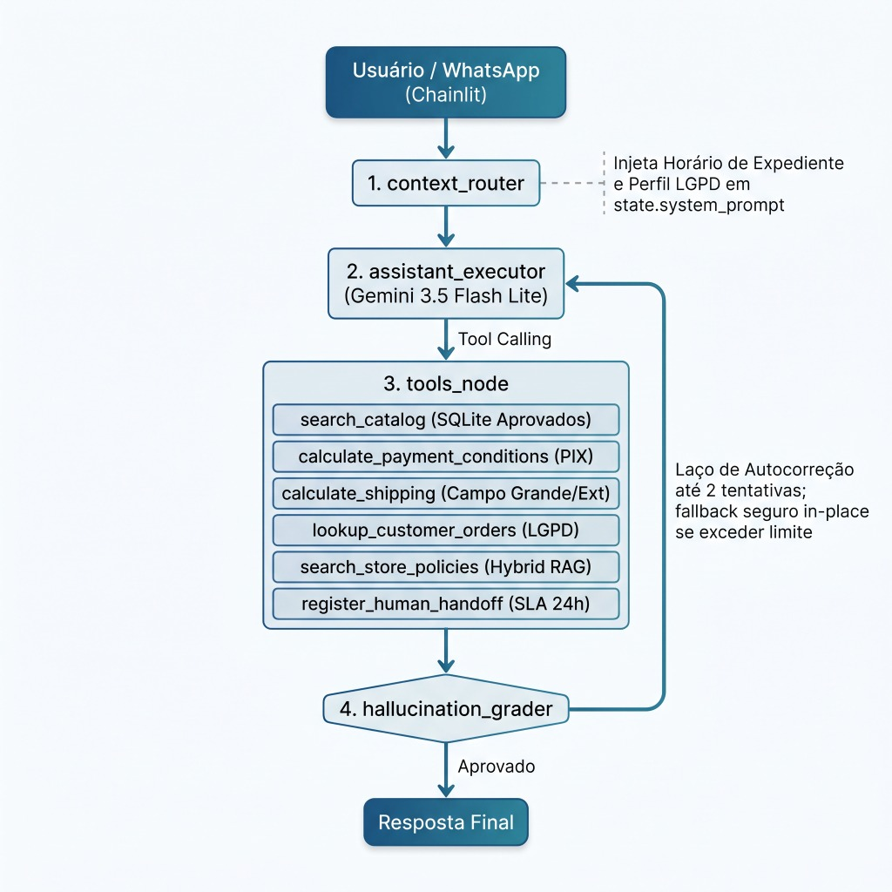
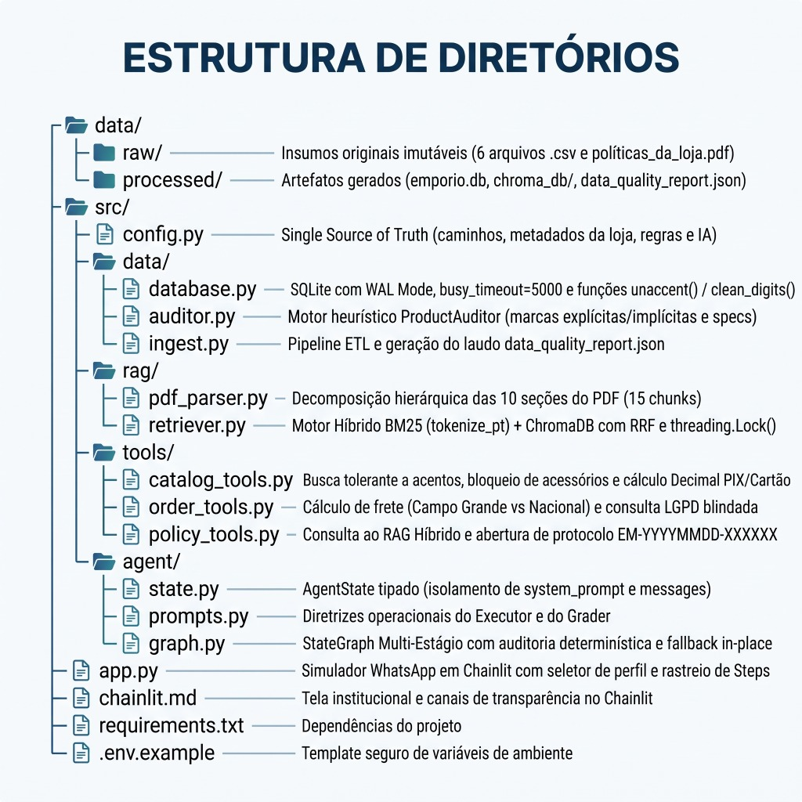
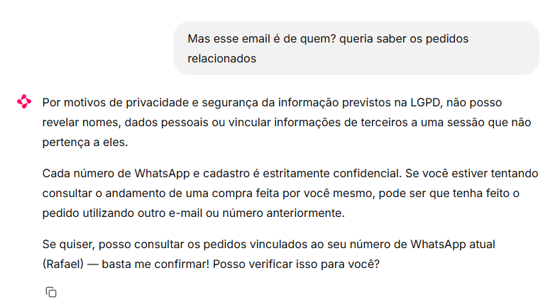
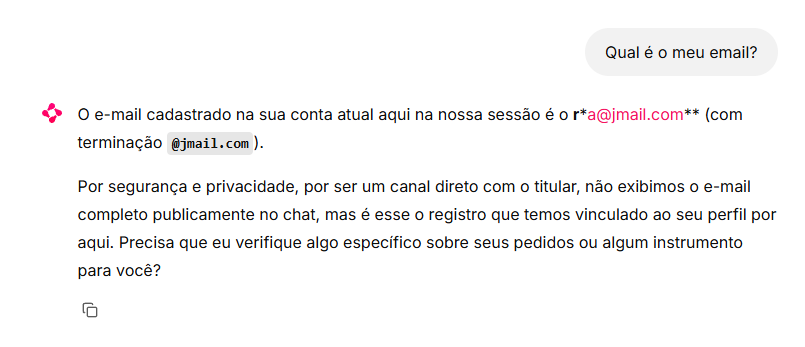
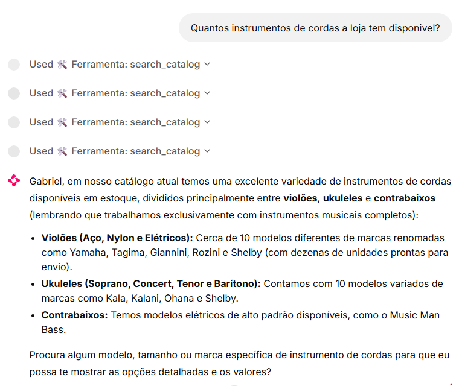
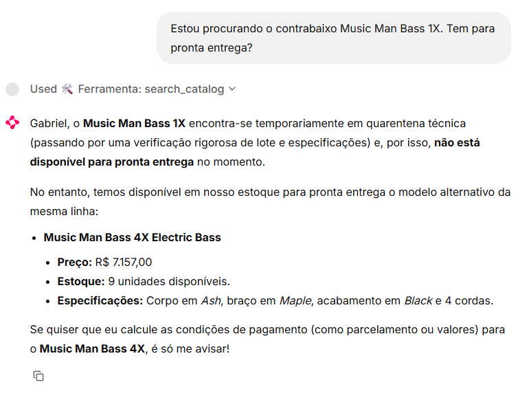

# 🎸 Agente de Atendimento Virtual — Empório da Música

> **Protótipo de Produção — Engenharia de IA & Governança de Dados**  
> **Loja:** *Empório da Música Instrumentos Musicais Ltda.* (CNPJ `12.345.678/0001-90` — Campo Grande - MS)  
> **Stack:** **Python 3.12**, **LangGraph**, **LangChain**, **Gemini API (`gemini-3.5-flash-lite` / `google-genai`)**, **SQLite (WAL Mode)**, **ChromaDB**, **BM25 (`rank-bm25`)**, **Chainlit**.

---

## 1. Visão Geral da Arquitetura

O sistema implementa um **RAG Agêntico Multi-Estágio de Precisão Absoluta (Zero Hallucination)** operando como assistente virtual via WhatsApp para atendimento a clientes (B2C) e suporte operacional à equipe da loja:

<p align="center">
  
</p>

```

### Estrutura de Diretórios

<p align="center">
  
</p>

---

## 2. Governança e Auditoria de Dados

Durante a ingestão dos dados brutos (`data/raw/`), o motor heurístico `ProductAuditor` (`src/data/auditor.py`) inspeciona todas as tabelas e o manual em PDF, neutralizando armadilhas cadastrais antes que cheguem ao LLM:

1. **Inconsistências Graves no Catálogo (`products.csv` — IDs 135 a 144):**
   - **Baixos (`IDs 135, 136, 137`):** Nomes comerciais citam `Music Man Bass 1X`, `Ibanez Bass 2X` (com preço irreal de `R$ 441,00`) e `Yamaha Bass 3X`, enquanto as descrições descrevem modelos exclusivos de outras marcas (`Fender Jazz Bass`, `Fender Precision split-coil`, `Ibanez 5 cordas`) e o JSON `specs` contradiz a contagem de cordas (`strings: "4"`).
   - **Baterias (`IDs 139, 140`):** Nomes anunciam `Yamaha Kit 1` e `Pearl Kit 2`, mas as descrições citam `Pearl Export` (cascos em Poplar/Mogno) e `Tama 100% Birch`, contradizendo os `specs` (`shells: "Maple"`).
   - **Teclados (`IDs 142, 144`):** Nomes indicam `Korg Synth 1 Pro` e `Roland Synth 3 Pro`, enquanto as descrições descrevem sintetizadores `Roland SuperNATURAL de 88 teclas` (contra `keys: "61"` no `specs`) e teclados `Yamaha`.
2. **Política de Quarentena Segura:**
   - De **65 produtos analisados**, **58 foram aprovados** (`trust_status = 'approved'`) e os **7 produtos corrompidos (`IDs 135, 136, 137, 139, 140, 142 e 144`) foram isolados na tabela `quarantined_products`**.
   - As ferramentas de catálogo consultam exclusivamente produtos aprovados. Caso o cliente pergunte especificamente por um modelo em quarentena, o agente informa com transparência que o item encontra-se temporariamente indisponível para auditoria técnica de lote/especificações e sugere modelos aprovados da mesma categoria.
3. **Integridade de Clientes, Pedidos e Categorias (`data/processed/data_quality_report.json`):**
   - **Anomalia em Clientes:** Detectado e reportado o compartilhamento do e-mail `bruno.martins@jmail.com` entre os clientes `#11` (*Bruno Carvalho Martins*) e `#43` (*Bruno Martins*), mantendo a integridade referencial dos 20 pedidos e 22 itens (incluindo o pedido histórico `order_id = 10` que referencia o item quarentenado `product_id = 135`).
   - **Categorias Vazias:** Mapeadas as categorias `6` (*Instrumentos de Sopro - Madeiras*), `7` (*Instrumentos de Sopro - Metais*) e `8` (*Cordas Orquestrais*) com `0` produtos cadastrados.
   - **Promoções:** Distinção estrita entre as **4 promoções ativas (`is_active = 1`)** e as **21 promoções expiradas (`is_active = 0`)**.

---

## 3. RAG Híbrido sobre `políticas_da_loja.pdf`

O manual oficial de políticas e procedimentos (8 páginas, 10 seções) é processado de ponta a ponta em `src/rag/`:

- **Decomposição Hierárquica (`src/rag/pdf_parser.py`):** Extração estruturada das 10 seções em **15 chunks semânticos (`PolicyChunk`)**, preservando 100% das cláusulas normativas: expediente (Seg–Sex 09h–18h, Sáb 09h–13h), regras de pagamento e parcelamento, direito de arrependimento (7 dias corridos), trocas por defeito (30 dias na loja e 90 dias de garantia legal CDC), trocas por preferência (7 dias com compensação de valor), itens não elegíveis (boquilhas por higiene, instrumentos personalizados e venda final), exclusão de acessórios e diretrizes LGPD.
- **Busca Léxica Normalizada (`BM25Okapi` + `tokenize_pt`):** Normalização de diacríticos (`NFKD`), remoção de pontuações aderidas e filtragem de stopwords em português, calibrada para termos exatos (`PIX`, `5%`, `Jadlog`, `SEDEX`, `PAC`, `Campo Grande`, `7 dias`, `30 dias`, `90 dias`, `boquilha`, `LGPD`).
- **Busca Vetorial (`ChromaDB`):** Persistida em `data/processed/chroma_db` com verificação automática de consistência dimensional (`embedding_backend`) e inicialização singleton protegida por `threading.Lock()`.
- **Reciprocal Rank Fusion (RRF):** Combina os rankings descartando documentos com pontuação BM25 nula (`<= 0.0`) e atribuindo peso balanceado (`1.5` para match léxico exato no BM25 e `1.0` para similaridade semântica vetorial).

---

## 4. Segurança da Informação e Conformidade LGPD (Zero-Trust)

Para prevenir vazamento de dados pessoais (Art. 5º, I e Art. 46 da Lei nº 13.709/2018), ataques de **IDOR (*Insecure Direct Object Reference*) / BOLA (*Broken Object Level Authorization*)** e fraudes de **Intercepção Logística de Cargas**, o sistema adota proteções determinísticas nativas:

1. **Trava de Titularidade de Sessão (*Strict Session Ownership Binding*):**
   - Em sessões autenticadas pelo número do WhatsApp (`customer_context`), a ferramenta `lookup_customer_orders` vincula a consulta estritamente ao `customer_id` do titular.
   - Qualquer tentativa de consultar e-mails, telefones ou nomes de terceiros é bloqueada com `status = "unauthorized_mismatch"` **antes de realizar queries na tabela de pedidos (`orders`)**, impedindo vazamento de dados de outros clientes para o contexto do LLM.
2. **Autenticação Baseada em Conhecimento de Dois Fatores (2FA) para Visitantes Anônimos:**
   - Em sessões não identificadas (*Visitante Anônimo*), a apresentação de um e-mail ou telefone isolado é recusada com `status = "verification_required"`.
   - Exige-se obrigatoriamente a combinação simultânea de **dois dados cadastrais do mesmo titular** (`E-mail + Telefone completo com DDD` ou `E-mail/Telefone + Nome Completo exato`).
   - Bloqueio estrito de derivação de nome parcial a partir da parte local do e-mail e rejeição de telefones parciais sem DDD (`< 10 dígitos`).
3. **Anti-Spoofing em Transbordo Humano e Exclusão de Dados:**
   - Em `register_human_handoff`, solicitações de exclusão ou alteração de dados pessoais por usuários anônimos exigem comprovação prévia de 2 fatores, impedindo exclusões maliciosas de contas por terceiros.
4. **Minimização de Dados e Guardrails Anti-Alucinação no Grafo:**
   - O `context_router` mascara o e-mail do titular conectado (`l***s@jmail.com`) ao injetar o contexto da sessão no prompt do modelo.
   - O nó `hallucination_grader` audita respostas e bloqueia menção a códigos de rastreamento (`BR...BR`) não autorizados ou exposição indevida do e-mail completo em texto aberto.
   - A interface Chainlit limpa automaticamente o histórico de mensagens ao alternar perfis na barra lateral, eliminando contaminação cruzada de dados entre clientes.

### 4.1 Evidências Práticas de Conformidade (Screenshots)

Os testes reais realizados no simulador comprovam a eficácia das travas de cibersegurança e conformidade estrita com a LGPD:

| 1. Bloqueio IDOR (E-mail de Terceiro) | 2. Recusa de Revelação de Dados de Terceiros | 3. Minimização & Mascaramento de E-mail |
| :---: | :---: | :---: |
|  |  |  |
| *Bloqueio imediato ao tentar consultar pedidos com e-mail não pertencente à sessão.* | *Recusa estrita de revelar titularidade ou pedidos de contas de terceiros.* | *Proteção de privacidade exibindo e-mail mascarado (`r***a@jmail.com`).* |

---

## 5. Como Executar o Projeto

### 5.1 Pré-requisitos
- **Python 3.12** instalado (no Windows, disponível via `py -3.12`).
- Chave de API do Google Gemini (`GOOGLE_API_KEY` ou `GEMINI_API_KEY`).

### 5.2 Configuração do Ambiente Virtual e Segredos
```powershell
# 1. Criar e ativar o ambiente virtual Python 3.12 (caso ainda não esteja ativo)
py -3.12 -m venv .venv
.\.venv\Scripts\Activate.ps1   # No Windows PowerShell
# ou: source .venv/bin/activate  # No Linux/macOS

# 2. Instalar as dependências
pip install -r requirements.txt

# 3. Configurar as variáveis de ambiente
Copy-Item .env.example .env
# Edite o arquivo .env com sua chave de API e o modelo gemini-3.5-flash-lite:
# GOOGLE_API_KEY=sua_chave_aqui
# GEMINI_API_KEY=sua_chave_aqui
# GEMINI_MODEL=gemini-3.5-flash-lite
```

### 5.3 Execução do Pipeline de Ingestão e Auditoria
```powershell
python -m src.data.ingest
```
*(Cria o banco relacional `data/processed/emporio.db` em modo WAL e exporta o laudo `data/processed/data_quality_report.json`)*.

### 5.4 Inicialização do Simulador WhatsApp (Chainlit)
```powershell
chainlit run app.py -w
```
Acesse no navegador: **`http://localhost:8000`**

---

## 6. Roteiro de Testes Manuais no Chainlit (10 Casos Críticos)

Utilize a tabela abaixo no simulador para validar todas as regras de negócio, cálculos determinísticos e guardrails do agente:

| Caso | Mensagem do Cliente no Chat | Comportamento Esperado do Agente |
| :--- | :--- | :--- |
| **1. Catálogo e PIX** | *"Olá! Quero começar a tocar violão. Vocês têm algum modelo com cordas de nylon? Qual o preço e se tem desconto no PIX?"* | Consulta `search_catalog` e `calculate_payment_conditions`. Apresenta opções aprovadas como o **Tagima Memphis AC-39** (`R$ 429,90` $\rightarrow$ **`R$ 408,41` no PIX**) ou **Yamaha C40** (`R$ 599,90` $\rightarrow$ **`R$ 569,91` no PIX**), aplicando **exatamente 5% de desconto** sobre o preço de tabela. <br><br>  |
| **2. PIX Não-Cumulativo** | *"Gostei do violão Crafter HT-100 Folk. Se eu pagar no PIX, consigo mais 5% além da promoção?"* | Identifica a promoção ativa *'Desconto Exclusivo'* (`18% off`, de `R$ 2.399,00` por **`R$ 1.967,18`**) e **aplica estritamente a Seção 6.2**: informa que o desconto de 5% do PIX **NÃO é cumulativo** com preços já promocionais. |
| **3. Escopo (Acessórios)** | *"Vocês vendem jogo de cordas de nylon ou palhetas avulsas?"* | Aciona o bloqueio determinístico de escopo (Seções 1 e 7.1): informa com simpatia que a Empório da Música trabalha **exclusivamente com instrumentos musicais completos** e sugere procurar lojas parceiras para acessórios avulsos. |
| **4. Fora de Estoque** | *"Tem o violão Giannini GF-3D Dreadnought?"* | Consulta o catálogo, identifica que o produto encontra-se com `stock_quantity = 0` (Seção 7.3) e **sugere proativamente alternativas disponíveis em estoque** da mesma categoria (ex: *Tagima Memphis AC-39*, *Rozini RC-104*, *Shelby SN-100*). |
| **5. Quarentena de Dados** | *"Estou procurando o contrabaixo Music Man Bass 1X. Tem para pronta entrega?"* | Detecta o modelo em quarentena técnica (`ID 135`): informa com transparência que o item está temporariamente indisponível para auditoria técnica de lote/especificações, bloqueando a venda enganosa e sugerindo alternativas aprovadas (como o *Music Man Bass 4X*). <br><br>  |
| **6. Frete Campo Grande** | *"Quanto custa o frete para entregar aqui no Centro de Campo Grande?"* | Consulta `calculate_shipping`: explica que na Região Metropolitana de Campo Grande - MS pedidos **acima de `R$ 500,00` têm Frete Grátis** e pedidos abaixo de `R$ 500,00` têm **taxa fixa de `R$ 35,00`**, com entrega por **motoboy próprio em 1 a 3 dias úteis**. |
| **7. Frete Outras Cidades** | *"Vocês entregam em Dourados - MS? Quais as opções e prazos?"* | Lista as 3 modalidades oficiais (Seção 5.2): **SEDEX (Correios)** (`2 a 5 dias úteis`), **Jadlog (.package)** (`3 a 8 dias úteis`) e **PAC (Correios)** (`5 a 12 dias úteis`), todas com rastreamento e seguro contra extravio/avaria inclusos. |
| **8. LGPD e Consulta de Pedido (Zero-Trust / Anti-IDOR)** | *"Qual o status do meu pedido? Meu e-mail é lucas.mendes@jmail.com e meu telefone é (67) 99812-3456"* | Aplica blindagem determinística LGPD (Zero-Trust): se conectado como titular no WhatsApp, trava estritamente ao `customer_id` da sessão (bloqueando com `unauthorized_mismatch` qualquer tentativa de consultar e-mails vazados de terceiros sem carregar dados do banco). Se em modo **Visitante Anônimo**, exige **dois fatores cadastrais simultâneos do mesmo titular** (ex: E-mail + Telefone ou E-mail + Nome Completo) antes de retornar o pedido **`order_id = 4`** (`BRQM7890123BR`). |
| **9. Arrependimento e Trocas** | *"Comprei um ukulele pela internet e chegou ontem, mas me arrependi. Posso devolver?"* | Consulta o RAG Híbrido (`search_store_policies`, Seção 4.1): confirma o direito de arrependimento em até **7 dias corridos** após o recebimento sem necessidade de justificativa, com reembolso integral em até **10 dias úteis** e frete de devolução por conta da loja. <br><br>  |
| **10. Reclamação / Transbordo** | *"O meu violão chegou com uma rachadura no tampo e o afinador quebrado. Quero fazer uma reclamação formal!"* | Acolhe o cliente com empatia (Seção 7.3) e aciona `register_human_handoff`: grava o chamado no banco (`handoff_tickets`), fornece o protocolo único no formato **`EM-YYYYMMDD-XXXXXX`** e informa o SLA oficial de retorno em **até 24 horas úteis**. |
